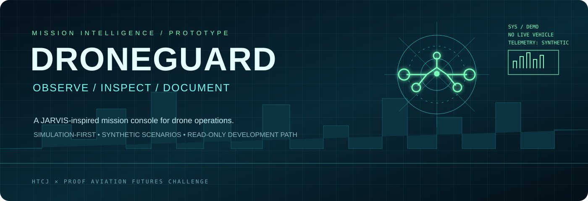

<div align="center">



# DRONEGUARD

### A JARVIS-inspired mission console for drone operations

**Observe. Inspect. Interpret. Document. Validate.**

[](https://u19725505-star.github.io/DroneGuard/)
[](JUDGE_GUIDE.md)
[](DEVPOST_SUBMISSION.md)
[](LICENSE)

**HTCJ × PROOF Aviation Futures Challenge** · AI + Flight Intelligence · Autonomy + Advanced Air Mobility

</div>

---

> [!IMPORTANT]
> **Honest demo boundary:** DroneGuard is an interactive browser prototype using illustrative/synthetic mission data. The hosted site is **not** connected to a live aircraft, live MAVLink telemetry, a deployed computer-vision model, or a validated PX4/Gazebo flight. No aircraft commands are sent. A cinematic scene is not evidence of real flight.

## Command center

| Launch point | What you'll find |
|---|---|
| **[Launch live console ↗](https://u19725505-star.github.io/DroneGuard/)** | Interactive five-view mission dashboard |
| **[Judge walkthrough ↗](JUDGE_GUIDE.md)** | 3–4 minute tour, rubric mapping, evidence boundaries |
| **[Devpost draft ↗](DEVPOST_SUBMISSION.md)** | Submission copy, target users, technology, final checklist |
| **[Source tree ↗](https://github.com/u19725505-star/DroneGuard)** | Dashboard, deployment workflow, and development scaffold |

<details open>
<summary><strong>⚡ 60-second guided tour</strong> — expand for the exact demo route</summary>

1. **Mission Map** — introduce the mission context and illustrative event timeline.
2. **Telemetry Lab** — inspect the telemetry-style panels; values are demo values, not sensor feeds.
3. **Anomaly Intelligence** — explore a synthetic alert and its surrounding context.
4. **Evidence & Response** — show how a simulated finding can be organized for follow-up.
5. **3D Mission Simulator** — use the available scenario controls to explore the browser-based scene.
6. **Close with the boundary** — this is an interface prototype, not a live drone-control system.

**Presenter line:** “DroneGuard demonstrates how mission context, a simulated anomaly, and an evidence workflow could live in one operator console. The next milestone is controlled simulator validation—not claiming the demo is already flying.”

</details>

## The mission problem

Drone operators and infrastructure-inspection teams need to interpret mission status, investigate potential anomalies, and retain context for follow-up. If an event and its evidence are hard to connect, a dashboard can show activity without helping a person understand what to inspect next.

DroneGuard explores a focused interaction pattern: **one mission view → inspect the signal → review the alert → organize evidence → define the next validation step.**

The prototype is intentionally simulation-first. It does not make flight decisions, certify an alert, or replace an operator.

## Explore the five console modules

| Module | What the reviewer can explore | Evidence status |
|---|---|---|
| **01 / Mission Map** | Mission overview and event timeline | Illustrative scenario |
| **02 / Telemetry Lab** | Telemetry-style values and mission-state presentation | Synthetic/demo values |
| **03 / Anomaly Intelligence** | Alert context and anomaly presentation | Synthetic/demo alerts; no validated detector claimed |
| **04 / Evidence & Response** | Simulated finding and follow-up workflow | Prototype workflow, not an approved procedure |
| **05 / 3D Mission Simulator** | Browser-based scene and available scenario controls | Illustrative visualization, not a PX4 flight recording |

## How the concept works

The diagram below shows the **intended operator workflow**, not a claim that a live telemetry or AI pipeline is already integrated.

```mermaid
flowchart LR
    A["Mission context"] --> B["Inspect signals"]
    B --> C["Review synthetic alert"]
    C --> D["Organize evidence"]
    D --> E["Define validation step"]
    E -. "future controlled testing" .-> F["PX4 SITL / Gazebo"]
    style A fill:#0b2633,stroke:#36d8d0,color:#eaffff
    style B fill:#0b2633,stroke:#36d8d0,color:#eaffff
    style C fill:#332616,stroke:#ffca72,color:#fff4db
    style D fill:#0b2633,stroke:#36d8d0,color:#eaffff
    style E fill:#103326,stroke:#7cffbd,color:#eafff4
    style F fill:#202b35,stroke:#8ba6b2,color:#eaf8ff
```



<details>
<summary><strong>🧭 Why the workflow is designed this way</strong></summary>

- **Context before alarm:** an alert should be reviewed alongside the mission context, not in isolation.
- **Evidence before certainty:** a displayed anomaly is a prompt for investigation, not proof that a real-world event occurred.
- **Traceable next steps:** the concept makes follow-up and validation visible instead of presenting a dramatic visualization as the outcome.
- **Simulation before deployment:** any future integration should begin with a reproducible, controlled simulator run.

These are design goals. They have not yet been validated in an operator study or real-world pilot.

</details>

## Capability and evidence matrix

| Capability | Current status |
|---|---|
| Publicly hosted browser dashboard | **Published** |
| Five navigable console views | **Implemented in the UI** |
| Interactive 3D scenario controls | **Illustrative browser simulation** |
| Anomaly and evidence presentation | **Synthetic/demo scenarios** |
| GitHub Pages deployment workflow | **Configured; see Actions** |
| PX4 SITL + Gazebo end-to-end run | **Not demonstrated / not claimed** |
| Live MAVLink in hosted dashboard | **Not connected** |
| Trained and validated CV/anomaly model | **Not included / not claimed** |
| Detection accuracy or safety improvement measured | **Not established** |
| Aviation certification or real-world pilot | **Not completed** |

<details>
<summary><strong>🔬 What would count as stronger proof?</strong></summary>

1. Reproduce a supported PX4 SITL + Gazebo baseline and document exact versions and commands.
2. Show the custom world loading successfully and the simulated aircraft visibly moving.
3. Capture the simulator directly; do not substitute a dashboard animation or terminal screen for flight evidence.
4. Label data by source and keep simulator telemetry separate from browser-generated demo values.
5. If a detector is added, document data provenance, labels, train/test separation, metrics, false positives, false negatives, and known limitations.
6. Get feedback from actual UAS operators and appropriate aviation/safety experts before proposing a pilot.

</details>

## Architecture at a glance

```text
DroneGuard/
├── index.html                     # Root dashboard entry point
├── web/
│   └── index.html                 # Dashboard source published by Pages
├── assets/
│   └── droneguard-banner.svg      # Repository hero artwork
├── scripts/
│   └── telemetry_probe.py         # Read-only local MAVLink probe scaffold
├── worlds/
│   └── urbanscape.sdf             # Scene-validation world scaffold
├── .github/workflows/
│   └── pages.yml                  # GitHub Pages deployment
├── JUDGE_GUIDE.md                 # Walkthrough and evidence map
├── DEVPOST_SUBMISSION.md          # Submission draft and checklist
└── README.md                      # Project overview
```

The root `index.html` and `web/index.html` are intended to stay synchronized. Three.js is loaded from a public CDN, so the 3D view requires an internet connection. The hosted demo does not require a paid AI API. GitHub Actions usage remains subject to the account's included minutes and storage limits.

## Run the demo

### Option A — hosted website

Open **[DroneGuard Live ↗](https://u19725505-star.github.io/DroneGuard/)** in a modern browser. Use the navigation to visit each module. Keep the synthetic/demo label visible when recording a presentation.

### Option B — local static preview

Clone the repository and open `web/index.html` in a browser. For the 3D module, ensure the browser can load the Three.js CDN module.

```bash
git clone https://github.com/u19725505-star/DroneGuard.git
cd DroneGuard
```

### Option C — future PX4/Gazebo validation

> This is a planned validation path, not proof that DroneGuard currently integrates end-to-end with PX4/Gazebo.

Start with the official setup documentation:

- [PX4 Linux development environment](https://docs.px4.io/main/en/dev_setup/dev_env_linux_ubuntu.html)
- [PX4 Gazebo simulation](https://docs.px4.io/main/en/sim_gazebo_gz/)

On a supported Ubuntu environment with PX4 dependencies installed, first test the official baseline:

```bash
cd PX4-Autopilot
make px4_sitl gz_x500
```

Validate the custom world separately after the baseline works. Gazebo versions, model names, and world-launch methods differ; do not assume the included SDF is already wired into a successful PX4 flight.

<details>
<summary><strong>🛰️ Read-only local telemetry probe</strong></summary>

The repository includes a read-only probe scaffold. Install `pymavlink` in the intended Python environment, then use the endpoint configured by your local SITL setup:

```bash
python -m pip install pymavlink
python scripts/telemetry_probe.py --endpoint udp:127.0.0.1:14540 --seconds 8
```

The probe is intended to print received state only; it sends no arm, takeoff, mission, or movement commands. Confirm the correct local endpoint for your setup because ports vary. This local probe is not a live data bridge for the hosted GitHub Pages site.

</details>

## Safety, privacy, and responsible use

- **Demo only:** do not use this prototype to make live flight decisions.
- **No vehicle commands:** the hosted dashboard does not arm, steer, or control an aircraft.
- **No public MAVLink exposure:** never expose a MAVLink endpoint directly to the public internet.
- **Protect sensitive information:** do not enter private operational or personal data into a public demo.
- **No false detections:** synthetic alerts do not establish that a real person, thermal target, infrastructure fault, or emergency was detected.
- **No certification claim:** any future field test needs appropriate engineering, aviation, privacy/security, and regulatory review.

## Roadmap — proof before promises

- [x] Publish the interactive dashboard on GitHub Pages.
- [x] Document the prototype's evidence boundaries.
- [x] Add judge walkthrough and submission draft.
- [ ] Record a concise screen walkthrough of the live website.
- [ ] Reproduce and document a supported PX4 SITL + Gazebo baseline.
- [ ] Validate and record the custom scene with visible simulated aircraft movement.
- [ ] Evaluate the mission-review workflow with UAS operators.
- [ ] Consider a safe, read-only simulator data bridge only after the baseline is reproducible.

## Challenge fit

DroneGuard aligns most closely with **AI + Flight Intelligence** and **Autonomy + Advanced Air Mobility** because it explores a mission-monitoring and anomaly-review workflow for UAS operations. Its current contribution is an interactive concept and a transparent demonstration—not a claim of novel, validated AI performance or an operational autonomous aircraft.

See the [judge walkthrough](JUDGE_GUIDE.md) for a rubric-by-rubric assessment and the [submission draft](DEVPOST_SUBMISSION.md) for adaptable project copy.

## License

Released under the [MIT License](LICENSE).

---

<div align="center">

**DRONEGUARD / MISSION INTELLIGENCE CONCEPT**

[Launch demo](https://u19725505-star.github.io/DroneGuard/) · [Judge guide](JUDGE_GUIDE.md) · [Submission draft](DEVPOST_SUBMISSION.md) · [Repository](https://github.com/u19725505-star/DroneGuard)

*Built as a simulation-first prototype. Proof is earned by reproducible tests, not visual effects.*

</div>
